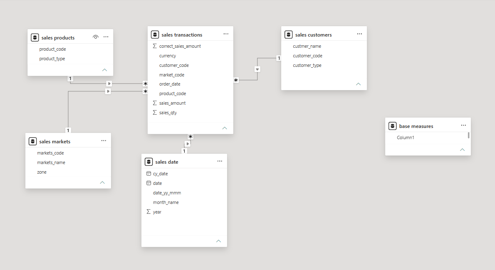

# AtliQ Sales Analysis (Power BI)

An interactive Power BI report on AtliQ sales data, built on a star-schema data model. It tracks revenue and sales quantity by market, customer and product over time, with year and month filters.

## Dashboard Preview

**Headline numbers:** 986.62M total revenue and 2M units sold.

- **Year and month slicers**: filter the whole page by year (2017 to 2020) and by month.
- **Top 5 customers by revenue**: bar chart of the highest-revenue customers.
- **Top 5 products**: bar chart of the highest-revenue products.
- **Revenue by market** and **sales quantity by market**: side-by-side bar charts across 14 Indian cities.
- **Revenue trend**: monthly line chart showing how revenue changed from 2018 to 2020.

## Data Model

The report uses a star schema with one fact table and four dimension tables, each linked one-to-many.

| Table                | Role      | Main columns                                                                                                              |
| -------------------- | --------- | ------------------------------------------------------------------------------------------------------------------------- |
| `sales transactions` | Fact      | `sales_amount`, `correct_sales_amount`, `sales_qty`, `currency`, `order_date`, plus keys for customer, market and product |
| `sales customers`    | Dimension | `customer_code`, customer name, `customer_type`                                                                           |
| `sales products`     | Dimension | `product_code`, `product_type`                                                                                            |
| `sales markets`      | Dimension | `markets_code`, `markets_name`, `zone`                                                                                    |
| `sales date`         | Dimension | `date`, `cy_date`, `date_yy_mmm`, `month_name`, `year`                                                                    |
| `base measures`      | Measures  | Holds the DAX measures for revenue and sales quantity                                                                     |

## Key Insights

- **Delhi dominates revenue**: 520.78M of 986.62M, about 53% of the total. Mumbai (150.18M) and Ahmedabad (132.53M) follow.
- **Sales are concentrated in a few customers**: the top customer, Electricalsara Stores, brings in 413.91M, around 42% of all revenue. The next four customers each contribute between 44M and 50M.
- **Revenue peaked in early 2018** at roughly 40M+ a month and then trended down through 2019 and 2020.
- **Several markets contribute very little**: Bhubaneshwar (0.89M) and Bengaluru (0.37M) are at the bottom.
- **Data quality note**: the top-products chart shows a `(Blank)` entry as its largest bar, which suggests transactions with a missing or unmatched product code. Worth cleaning up in the source data.

## Tools and Techniques

- Power BI Desktop
- Star-schema data modelling with one-to-many relationships
- DAX measures in a dedicated measures table
- Date table with year and month fields
- Slicers, bar charts, line chart and KPI cards

## Files

| File                  | Description                |
| --------------------- | -------------------------- |
| `atliq_analysis.pbix` | Power BI report            |
| `screenshots/`        | Images used in this README |

## How to Open

1. Install [Power BI Desktop](https://powerbi.microsoft.com/desktop/) (free, Windows only).
2. Download the `.pbix` file from this repo.
3. Open it in Power BI Desktop.

## Author

Rakshit ([@Rakshiii365](https://github.com/Rakshiii365))
